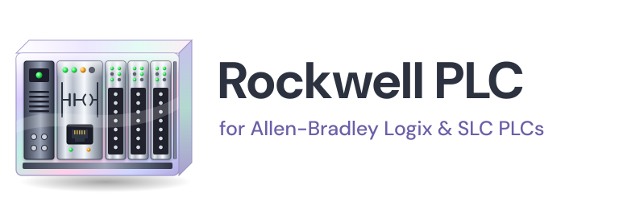

# Rockwell PLC (EtherNet/IP) for Home Assistant



A custom integration that reads (and, if you allow it, writes) Allen-Bradley PLC data over EtherNet/IP using [pycomm3](https://github.com/ottowayi/pycomm3).

| PLC family | How you address data | Notes |
|---|---|---|
| **Logix 5000**: ControlLogix, CompactLogix, GuardLogix | Tag names: `Tank_Level`, `Program:Main.Setpoint`, `MyUDT.Member`, `MyDint.5`, `MyArray[3]` | Path is `IP`, `IP/slot` or a full route |
| **SLC 500 / MicroLogix** (PCCC) | Data-table addresses: `N7:0`, `F8:3`, `B3:0/5`, `T4:0.ACC`, `I:0/1` | Needs native Ethernet (SLC 5/05, ML1100/1400) or a 1761-NET-ENI |

Everything is local polling, and each scan reads all tags in one batched request. The connection stays open and reconnects on its own after a failure.

## Install

**HACS (recommended):** open HACS, search for **Rockwell PLC** → download → restart HA.

[](https://my.home-assistant.io/redirect/hacs_repository/?owner=KC9OXP&repository=ha-rockwell-plc&category=integration)

**HACS custom repository (fallback):** if it doesn't show up in search, HACS → ⋮ → Custom repositories → add this repo's URL, category *Integration* → download → restart HA.

**Manual:** copy `custom_components/rockwell_plc` into `/config/custom_components/` → restart HA.

Then go to **Settings → Devices & Services → Add Integration → Rockwell PLC**. Home Assistant installs pycomm3 automatically the first time the integration loads.

## Setup

1. **Connect:** give it a name, the IP or path and the PLC family. It test-connects before saving.
2. **Options** (can be changed later with *Configure*):
   - **Scan interval:** in seconds (default 5).
   - **Allow writes:** default **off**. While it's off, `switch` tags appear as binary sensors, `number` tags appear as sensors and `button` tags are skipped. Nothing can write.
   - **Allow write_tag service:** default **off**. Turning it on lets automations or scripts write **any** tag through `rockwell_plc.write_tag`.
   - **Tags:** a YAML list (see below).

Saving options reloads the integration.

## Tag list

```yaml
# Logix example
- tag: Tank1.Level            # REAL or DINT
  name: Tank 1 Level
  platform: sensor            # default
  unit: "%"
  scale: 0.1                  # HA value = raw * scale + offset
  offset: 0
  precision: 1
  state_class: measurement
  device_class: null          # any HA sensor device class, e.g. temperature, pressure

- tag: Pump1.Running
  name: Pump 1 Running
  platform: binary_sensor
  device_class: running
  invert: false

- tag: HMI.Pump1_Enable       # BOOL, maintained
  name: Pump 1 Enable
  platform: switch

- tag: HMI.Tank1_SP           # setpoint
  name: Tank 1 Setpoint
  platform: number
  min: 0
  max: 100
  step: 0.5
  unit: "%"
  mode: box                   # box | slider | auto

- tag: HMI.Pump1_Start_PB     # momentary pushbutton
  name: Pump 1 Start
  platform: button
  press_value: true
  release_value: false
  pulse_ms: 500               # 0 = write press_value only

# SLC / MicroLogix example
- tag: N7:0
  name: Line Speed
  unit: fpm
- tag: B3:0/5
  name: Aux Running
  platform: binary_sensor
- tag: F8:2
  name: Temp SP
  platform: number
  min: 32
  max: 212
```

Allowed keys: `tag` (required), `name`, `platform`, `unit`, `scale`, `offset`, `precision`, `device_class`, `state_class`, `icon`, `min`, `max`, `step`, `mode`, `invert`, `press_value`, `release_value`, `pulse_ms`. Any other key, or a bad value, is rejected when you save, and the form shows why.

Writes match the data type of the value last read from the PLC: an INT/DINT target gets a rounded integer and a BOOL gets true/false. `scale` and `offset` are reversed on write, so a number entity shows engineering units and writes raw counts.

A whole UDT or array read as a sensor shows no state and puts the full value in the entity's `value` attribute.

## Services

```yaml
# Read anything on demand (always allowed). Returns {tag, value, error}.
action: rockwell_plc.read_tag
data:
  config_entry_id: <pick the PLC in the UI>
  tag: Program:Main.Counter
response_variable: result

# Write anything (only if "Allow write_tag service" is on for that PLC)
action: rockwell_plc.write_tag
data:
  config_entry_id: <pick the PLC>
  tag: N7:10
  value: 250
```

## Safety

- Writes are off by default, at two separate levels: entities and the service.
- Write to HMI or interface tags that your logic validates. Don't write straight to outputs, and never use this for anything safety-rated. GuardLogix rejects external writes to safety tags anyway.
- Every successful write is logged at INFO level as `Wrote <tag> = <value> to <path>`.

## Troubleshooting

Add this to `configuration.yaml` to get detailed logs:

```yaml
logger:
  logs:
    custom_components.rockwell_plc: debug
    pycomm3: debug
```

- **Tag read error, entity unavailable:** check the tag's spelling and scope. Program-scoped tags need `Program:<name>.<tag>`.
- **Logix CPU not in slot 0:** use `IP/slot`, e.g. `192.168.1.10/2`.
- **First connect is slow on a big Logix program:** pycomm3 uploads the tag list when it connects, which can take a few seconds.

## Development

`tests/test_core.py` tests the tag parser and the PLC wrapper against a fake pycomm3 driver. It needs only PyYAML: `python3 tests/test_core.py`.

## Trademarks

This is an independent community project. It is not affiliated with, endorsed by or supported by Rockwell Automation. Rockwell Automation, Allen-Bradley, Logix, ControlLogix, CompactLogix, GuardLogix, SLC and MicroLogix are trademarks of Rockwell Automation, Inc., used here only to describe which controllers the integration works with. The icon in `brand/` is original artwork (source SVGs in `art/`).
